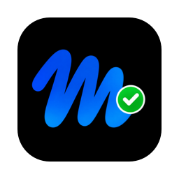

<p align="center"></p>

<h1 align="center">MuseAutoAllow</h1>

<p align="center">Menu-bar app for macOS that auto-approves Muse's approval prompts (file uploads by default), so agent tasks don't stall waiting for you.</p>

<p align="center">
  <a href="../../releases/latest"></a>
  
  
</p>

- One switch per prompt type: **file uploads** (on by default), **web access and sharing**, **form submits and clicks**, **app actions** (email, Slack…).
- Always presses the narrowest option (Allow once / Allow for this task), never "Always allow".
- Purchases, checkout, bookings, payments, sign-ins and credential warnings always ask you.
- Works with any agent name; needs Muse's UI in English.
- Status badge in the menu bar: ✓ active, ‖ paused, ! needs Accessibility, ○ Muse not running.
- Liquid Glass panel with session and all-time counts, recent uploads, pause and launch at login.
- Works with Muse in the background (no mouse movement).

## Install

1. Download `MuseAutoAllow.zip` from [Releases](../../releases/latest), unzip, move to Applications.
2. It isn't notarized: right-click → **Open**, or `xattr -dr com.apple.quarantine /path/to/MuseAutoAllow.app`.
3. Allow **MuseAutoAllow** in System Settings → Privacy & Security → Accessibility.

> [!WARNING]
> While it runs, the Muse agent can do everything you've switched on (by default, upload files to any site) without asking. Pause it when you're not watching a task you trust.

## Build

```sh
./build.sh           # self-check + universal .app and .zip in build/
./build.sh install   # also installs to ~/Applications and launches
```

Ad-hoc builds lose the Accessibility grant on every rebuild. Create a code-signing certificate named `MuseAutoAllow Local Signing` (Keychain Access → Certificate Assistant) and trust it for code signing to keep it. `build.sh` picks it up automatically.

---

MIT · Not affiliated with Meta or Muse.
